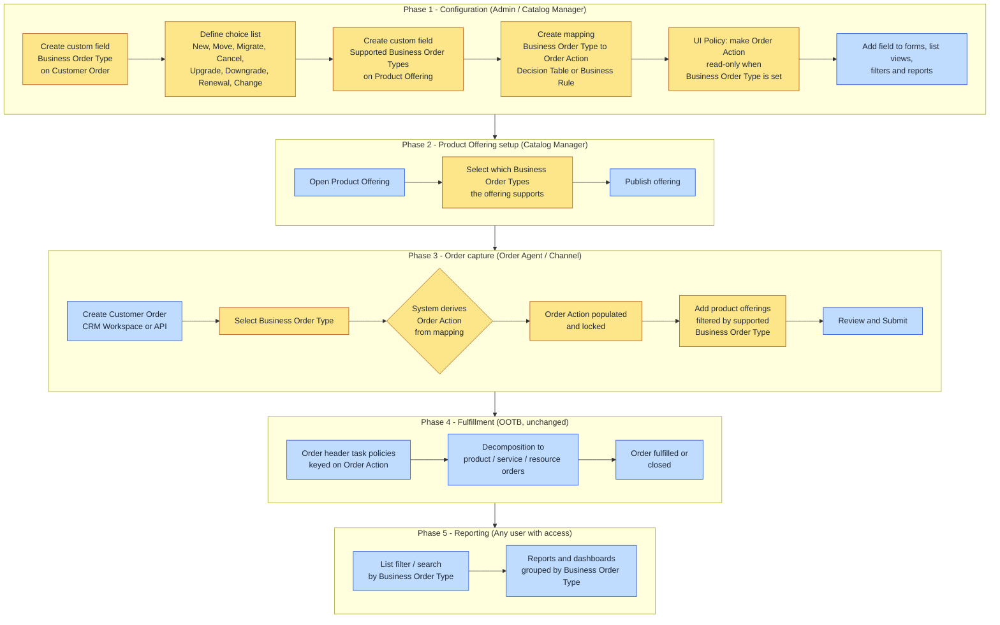
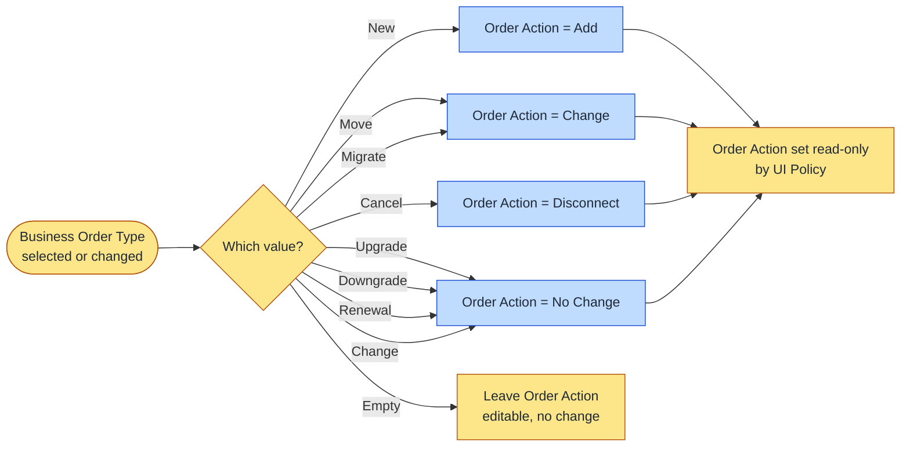
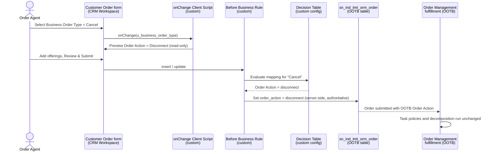
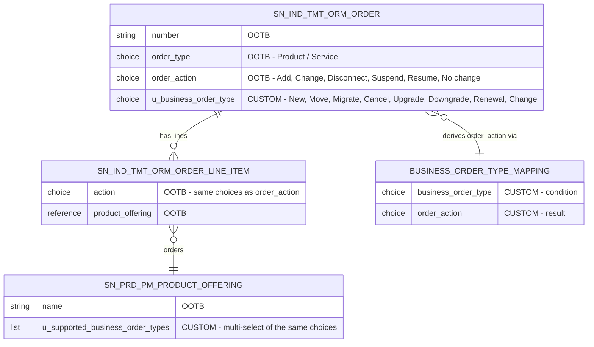

# Business Order Type: custom vs OOTB analysis and process flow

This document answers two questions about the "Order Type configuration" requirement:

1. Which parts of the requirement already exist out of the box (OOTB) in ServiceNow Order Management, and which parts must be built as customization.
2. How the end-to-end process works once it is implemented, shown as process flow diagrams.

The source product documentation used for the OOTB facts lives in this repository:

- [Action types for customer and service orders](../markdown/order-management/order-mgt-customer-order-types.md)
- [Customer and Service order details forms](../markdown/order-management/field-descriptions-customer-orders.md)
- [Customer order line item form fields](../markdown/order-management/field-descriptions-customer-order-line-items.md)
- [Request post-sale change orders](../markdown/order-management/create-macd-orders.md)
- [Configure order task policies](../markdown/order-management/configure-order-task-policy.md)
- [Create a product offering](../markdown/order-management/som-create-product-offering.md)

---

## 1. Short answer: the field is custom, the thing it drives is OOTB

| Requirement element | OOTB or custom | Where it lives | Notes |
|---|---|---|---|
| **Business Order Type** field on the order record | **Custom** | New choice field on Customer Order (`sn_ind_tmt_orm_order`) | Does not exist in the product. Must be created. |
| Values New, Move, Migrate, Cancel, Upgrade, Downgrade, Renewal, Change | **Custom** | Choice list (`sys_choice`) for the new field | None of these are OOTB choices on any order field. |
| **Order Action** field on the order | **OOTB** | `order_action` on `sn_ind_tmt_orm_order` | Shipped by Order Management. Values: Add, Change, Disconnect, Suspend, Resume, No change. "Move" is deprecated OOTB. |
| **Order line action** on order line items | **OOTB** | `action` on `sn_ind_tmt_orm_order_line_item` | Same choice set as Order Action. Not changed by this requirement. |
| Existing **Order Type** field (Product / Service) | **OOTB** | `order_type` on `sn_ind_tmt_orm_order` | Already taken. This is why the new field must be labelled **Business Order Type**, not "Order Type". |
| Business Order Type configurable on **Product Offerings** | **Custom** | New field on Product Offering (`sn_prd_pm_product_offering`) | OOTB offerings have no concept of business order type. |
| Order Action **auto-populated** from Business Order Type | **Custom** | Business Rule (or Flow) plus optional Decision Table | OOTB has no derivation logic; agents pick Order Action manually. |
| Order Action **read-only / system-derived** | **Custom** | UI Policy on the order form | OOTB the field is editable. |
| Report, filter, search by Business Order Type | **OOTB platform capability** | List views, filters, Reports, Performance Analytics | Any choice field is automatically reportable once it exists. Only list layout / dashboard setup is needed. |

**Conclusion.** The requirement adds a **custom business-language layer** (Business Order Type) on top of the **OOTB fulfillment-language layer** (Order Action). The OOTB Order Action values are not modified, which keeps order decomposition, task policies, and the TMF order APIs working as shipped.

---

## 2. Why Order Action must stay OOTB and unchanged

Order Action is not a cosmetic field. The product uses it to drive behaviour:

- **Order header tasks** are generated from order-level parameters such as account and Order Action (see [configure-order-task-policy](../markdown/order-management/configure-order-task-policy.md)).
- **Order decomposition** rules are applied to Add and Change lines and skipped for Disconnect lines (see [order-decomposition-examples](../markdown/order-management/order-decomposition-examples.md)).
- **Post-sale (MACD) flows** key off Change, Disconnect, Suspend and Resume (see [create-macd-orders](../markdown/order-management/create-macd-orders.md)).
- **No change** lines are informational only and do not trigger fulfillment.

Adding or renaming OOTB choices would break these behaviours and complicate upgrades. Deriving Order Action from a new field is the right pattern.

---

## 3. Mapping table (as specified)

| Business Order Type (custom) | Order Action (OOTB) | Order Action meaning in the product |
|---|---|---|
| New | Add | New order, new fulfillment activities |
| Move | Change | Change of service location (OOTB "Move" action is deprecated, so Change is correct) |
| Migrate | Change | Change of product / specification |
| Cancel | Disconnect | Terminate an active product or service |
| Upgrade | No Change | Informational line, no fulfillment triggered (see risk R1) |
| Downgrade | No Change | Informational line, no fulfillment triggered (see risk R1) |
| Renewal | No Change | Informational line, no fulfillment triggered |
| Change | No Change | Informational line, no fulfillment triggered (see risk R1) |

---

## 4. Process flow diagrams

### 4.1 End-to-end process (configure, capture, derive, fulfil, report)

Legend: yellow = custom build, blue = OOTB capability used as shipped.

### 4.2 Order Action derivation logic

### 4.3 Runtime sequence when an agent creates an order

The server-side rule is the source of truth. The client script only gives immediate visual feedback. This guarantees the mapping also applies to orders created through APIs, imports or integrations where no form is involved.

### 4.4 Data model: custom additions on OOTB tables

Field names shown with the `u_` prefix assume a global-scope build. In a scoped application they will carry the application prefix instead (for example `x_acme_bot_business_order_type`). The mapping entity can be a Decision Table (recommended) or hard-coded in the Business Rule.

---

## 5. Recommended build components

| # | Component | Type | Custom / OOTB | Purpose |
|---|---|---|---|---|
| 1 | `u_business_order_type` on `sn_ind_tmt_orm_order` | Dictionary entry (Choice) | Custom | The Business Order Type field |
| 2 | Choice list with the 8 values | `sys_choice` | Custom | Selectable values |
| 3 | `u_supported_business_order_types` on `sn_prd_pm_product_offering` | Dictionary entry (List / multi-choice) | Custom | Which business order types an offering supports |
| 4 | "Business Order Type to Order Action" | Decision Table | Custom | Maintainable mapping, no code change to alter it |
| 5 | "Derive Order Action from Business Order Type" | Business Rule, before insert/update, runs when Business Order Type changes | Custom | Authoritative server-side derivation |
| 6 | "Preview Order Action" | Client Script, onChange | Custom (optional) | Immediate feedback on the form |
| 7 | "Lock Order Action" | UI Policy | Custom | Order Action read-only when Business Order Type is set |
| 8 | Form / workspace view updates | Form layout, UI Builder form view | Configuration | Field visible in CRM Workspace and classic UI |
| 9 | List layout, filter, report | List / Report configuration | Configuration | Reporting and search |
| 10 | Order Action choices | `sys_choice` on `order_action` | OOTB, untouched | Standard values remain unchanged |

Build in a **scoped application** where possible. Writing to `sn_ind_tmt_orm_order` and `sn_prd_pm_product_offering` from another scope requires the target application to allow cross-scope access; if that is blocked, create the fields in global scope with the `u_` prefix.

---

## 6. Risks and clarifications to confirm with the business

- **R1 - Upgrade, Downgrade and Change mapped to No Change.** OOTB, "No change" lines are informational only and do not trigger fulfillment. The product documentation gives an upgrade (100 Mbps to 1000 Mbps) as the canonical example of the **Change** action. If these business order types are expected to trigger fulfillment, the mapping should be Change, not No Change. Implement as specified, but get written confirmation.
- **R2 - "Cancel" vs OOTB cancel.** OOTB, cancelling an in-flight order is a Revision Operation (Cancel) on the order, not an Order Action. Business Order Type "Cancel" mapped to Disconnect means terminating an already active service. Make sure users understand the two are different.
- **R3 - Header versus line level.** Order Action is a header field; each line also has its own Order line action. The requirement only mentions the order record. Decide whether lines should inherit the derived action (they usually should for Add and Disconnect).
- **R4 - Inbound API orders.** Orders arriving via TMF622 or the inbound queue will not carry Business Order Type unless the payload mapping is extended. The server-side rule handles derivation once the field is set; the integration mapping is a separate piece of work.
- **R5 - Label collision.** "Order Type" already exists OOTB (Product / Service). Always use the label "Business Order Type" to avoid confusion in forms, reports and conversations.
- **R6 - Product Offering enforcement.** The requirement says the field is "available for configuration" on offerings. It does not say the catalog must block an offering that does not support the selected Business Order Type. Confirm whether enforcement (validation at Review and Submit) is in scope.

---

## 7. Definition of done, mapped to the acceptance criteria

| Acceptance criterion | How to verify | Component |
|---|---|---|
| Business Order Type field available on the order record | Open a Customer Order in CRM Workspace and classic UI; field is visible and editable | 1, 8 |
| Values New, Move, Migrate, Cancel, Upgrade, Downgrade, Renewal, Change available | Open the choice list; all 8 values present, no extras | 2 |
| Field available for configuration against Product Offerings | Open a Product Offering; supported Business Order Types can be selected and saved | 3 |
| Standard Order Action values remain unchanged | Compare `order_action` choices before and after: Add, Change, Disconnect, Suspend, Resume, No change | 10 |
| Order Action auto-populated per mapping | For each of the 8 values, create an order and confirm the derived Order Action matches the table | 4, 5, 6 |
| Order Action is system-derived and populated when Business Order Type is selected | Field is read-only once Business Order Type is set; value is also correct for an order inserted via REST without using the form | 5, 7 |
| Users can report, filter and search by Business Order Type | Add filter "Business Order Type is Cancel" to the order list; build a report grouped by Business Order Type | 9 |
